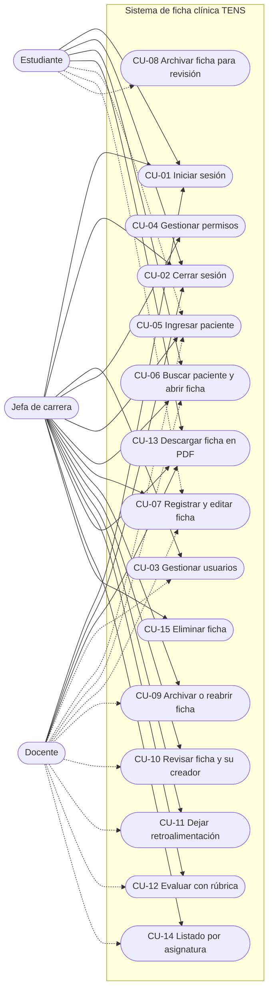

# Casos de uso descritos

Sistema de **ficha clínica de simulación** para estudiantes de Técnico en Enfermería de Nivel Superior (TENS) del CFT O'Higgins. Los pacientes y sus datos son **ficticios** (simulación clínica).

## Actores

| Actor | Rol en el sistema | Descripción |
|---|---|---|
| **Jefa de carrera** | `admin` | Acceso completo: usuarios, permisos, fichas, retroalimentación y reportes. |
| **Docente** | `docente` | Revisa fichas, ingresa pacientes y retroalimenta. Sus capacidades dependen de los permisos que le asigne la jefatura. |
| **Estudiante** | `alumno` | Ingresa pacientes, registra en sus propias fichas y las archiva para revisión. Solo ve las fichas que él creó. |

## Vista general

Línea continua: el actor siempre puede. Línea punteada: requiere que la jefatura le haya asignado el permiso.

## Matriz de permisos

| Acción | Jefa de carrera | Docente | Estudiante |
|---|---|---|---|
| Iniciar y cerrar sesión | Sí | Sí | Sí |
| Crear, editar y eliminar docentes | Sí | No | No |
| Crear, editar y eliminar estudiantes | Sí | Con `gestionar_alumnos` | No |
| Asignar permisos | Sí | No | No |
| Ver lista y fichas | Sí (todas) | Con `ver_fichas` (todas) | Solo las que él creó |
| Ingresar paciente | Sí | Con `ingresar_pacientes` | Con `registrar_fichas` |
| Editar ficha abierta | Sí | Con `ingresar_pacientes` | Con `registrar_fichas`, solo las suyas |
| Editar ficha archivada | Sí | Con `ingresar_pacientes` | No |
| Archivar ficha | Sí | Con `ingresar_pacientes` o `retroalimentar` | Con `registrar_fichas`, solo las suyas |
| Reabrir ficha archivada | Sí | Con `ingresar_pacientes` o `retroalimentar` | No |
| Comentar y evaluar con rúbrica | Sí | Con `retroalimentar` | No (solo lectura) |
| Ver quién creó la ficha (nombre y correo) | Sí | Sí (con acceso a fichas) | No |
| Filtrar las fichas creadas por un usuario | Sí | Con `ver_fichas` | No |
| Listado por asignatura | Sí | Con `ver_fichas` | No |
| Eliminar ficha | Sí | No | No |
| Descargar ficha en PDF | Sí | Sí | Sí |

Valores por defecto al crear un usuario: el docente nace con sus cuatro permisos activos; el estudiante, con `registrar_fichas`. La jefatura los ajusta desde el botón **Permisos**.

## Reglas de negocio generales

- **RN-01** La ficha clínica es **única por paciente**: no pueden existir dos fichas con el mismo RUN.
- **RN-02** Los datos de pacientes son ficticios. No se suben archivos al sistema.
- **RN-03** Todo acceso exige iniciar sesión con correo institucional y contraseña.
- **RN-04** Los permisos se verifican en el servidor en cada operación, no solo en la pantalla.
- **RN-05** Una ficha archivada queda de solo lectura para el estudiante.
- **RN-06** Si dos personas editan la misma ficha, el sistema avisa y no sobrescribe cambios ajenos.
- **RN-07** Al eliminar un usuario, las fichas que creó se conservan.
- **RN-08** La jefa de carrera no puede eliminarse a sí misma ni a otras jefaturas; un docente solo puede gestionar estudiantes.
- **RN-10** Los correos de docentes y estudiantes deben terminar en `@salud.cftohiggins.cl` (se valida en la pantalla y en el servidor). La cuenta de jefatura creada por el instalador conserva `admin@cftohiggins.cl`.
- **RN-11** La asignatura de cada ficha solo puede ser **TENS** o **Podología** (lista cerrada, validada en pantalla y en el servidor). No se aceptan otras carreras.
- **RN-09** El estudiante solo ve y edita las fichas que **él mismo creó**; no puede ver las de sus compañeros. La jefa de carrera y los docentes ven todas las fichas, con su creador, y pueden filtrar para ver las de un usuario en particular.

---

## CU-01 Iniciar sesión
- **Actores:** Jefa de carrera, Docente, Estudiante.
- **Precondición:** La persona tiene una cuenta creada.
- **Flujo principal:**
  1. Abre la página de inicio e ingresa correo y contraseña.
  2. El sistema valida el formato y verifica las credenciales.
  3. Crea la sesión y redirige al panel con las opciones según el rol.
- **Alternativos:**
  - Correo o contraseña incorrectos: mensaje genérico, sin indicar cuál falló.
  - Formato de correo inválido o contraseña vacía: se marca el campo y no se envía.
  - Sin conexión con el servidor: mensaje de error.
  - Si ya había una sesión activa, entra directo al panel.
- **Postcondición:** Sesión activa. Opcionalmente se recuerda el correo en el equipo.
- **Reglas:** RN-03.

## CU-02 Cerrar sesión
- **Actores:** Todos.
- **Precondición:** Sesión activa.
- **Flujo principal:** (1) Pulsa **Salir**. (2) El sistema destruye la sesión. (3) Vuelve a la pantalla de inicio.
- **Postcondición:** Sin sesión; el panel ya no es accesible.

## CU-03 Gestionar usuarios
- **Actores:** Jefa de carrera; Docente con permiso `gestionar_alumnos` (solo estudiantes).
- **Precondición:** Sesión activa y permiso correspondiente.
- **Flujo principal (crear):**
  1. Entra a **Usuarios** y pulsa **Nuevo usuario** (la jefa elige rol docente o estudiante; el docente solo crea estudiantes).
  2. Ingresa nombre, correo (ej. `maria@salud.cftohiggins.cl`) y contraseña inicial.
  3. El sistema valida, guarda la contraseña cifrada y asigna los permisos por defecto.
  4. El usuario aparece en la lista.
- **Flujo (editar):** Cambia nombre o correo; la contraseña es opcional (si queda vacía, no cambia).
- **Flujo (eliminar):** Confirma; el usuario se elimina y sus fichas se conservan.
- **Alternativos:** correo ya registrado; correo que no termina en `@salud.cftohiggins.cl`; contraseña menor a 6 caracteres; correo inválido; intento sobre un usuario no autorizado (rechazado por el servidor).
- **Postcondición:** Lista de usuarios actualizada.
- **Reglas:** RN-07, RN-08.

## CU-04 Gestionar permisos
- **Actor:** Jefa de carrera.
- **Precondición:** Existen docentes o estudiantes.
- **Flujo principal:**
  1. Pulsa **Permisos**.
  2. Ve cada docente y estudiante con sus casillas (docente: ver fichas, ingresar pacientes y editar, retroalimentar y evaluar, gestionar estudiantes; estudiante: ingresar y registrar en fichas).
  3. Marca o desmarca; cada cambio se guarda al instante.
- **Alternativos:** si falla el guardado, la casilla vuelve a su valor anterior y se muestra el error.
- **Postcondición:** El cambio rige desde la siguiente acción del usuario afectado (el servidor lo verifica en cada petición).

## CU-05 Ingresar paciente
- **Actores:** Jefa de carrera; Docente con `ingresar_pacientes`; Estudiante con `registrar_fichas`.
- **Precondición:** Sesión activa y permiso.
- **Flujo principal:**
  1. Pulsa **Ingresar paciente**.
  2. Completa nombre (ficticio), RUN (ficticio) y elige la asignatura entre **TENS** y **Podología**.
  3. El sistema normaliza el RUN, verifica que no exista y crea la ficha en estado *abierta*, registrando quién la creó.
  4. Se abre la ficha para comenzar a completarla.
- **Alternativos:**
  - RUN con formato inválido.
  - **RUN ya existente:** se rechaza (ficha única por paciente), aunque la ficha existente la haya creado otra persona. El estudiante no la ve; debe pedir apoyo al docente.
  - Campos vacíos.
- **Postcondición:** Nueva ficha abierta.
- **Reglas:** RN-01, RN-02.

## CU-06 Buscar paciente y abrir ficha
- **Actores:** Jefa de carrera; Estudiante; Docente con `ver_fichas`.
- **Flujo principal:**
  1. En **Pacientes y fichas** escribe parte del nombre o del RUN (con o sin puntos y guion).
  2. Opcionalmente filtra por estado (abiertas o archivadas) y, si es docente o jefa, por **quién creó** la ficha. El estudiante solo ve y busca entre las fichas que él creó.
  3. La lista se actualiza sola; pulsa **Abrir ficha**.
- **Alternativos:** sin coincidencias, aparece un mensaje; un docente sin `ver_fichas` ve que no tiene permiso.
- **Postcondición:** Ficha abierta en pantalla completa.

## CU-07 Registrar y editar la ficha clínica
- **Actores:** Jefa de carrera; Docente con `ingresar_pacientes`; Estudiante con `registrar_fichas` (solo sus propias fichas y si están abiertas).
- **Precondición:** Ficha abierta en pantalla.
- **Flujo principal:**
  1. Completa las secciones en sus pestañas: **Ingreso** (actividad, identificación, motivo, antecedentes, antropometría, examen físico, dispositivos, problemas y firmas), **Signos vitales**, **Medicamentos**, **Notas de enfermería**, **Balance hídrico** y **Escalas** (Glasgow, Braden, Downton).
  2. Agrega filas con **Agregar registro** en las tablas de seguimiento.
  3. El sistema calcula en vivo edad, IMC, PAM, alertas por valores fuera de rango, verificación de los 5 correctos, totales y balance acumulado, y puntajes e interpretación de las escalas.
  4. A los 1,5 segundos de dejar de escribir, se guarda solo; el indicador muestra el estado.
- **Alternativos:**
  - Conflicto de versión: otra persona guardó antes; se avisa y hay que reabrir la ficha.
  - Ficha archivada o sin permiso: queda en solo lectura.
  - Sesión vencida o error de red: se muestra el mensaje y los cambios quedan sin guardar.
  - Se intenta cambiar el RUN por uno que ya tiene otra ficha: se rechaza.
- **Postcondición:** Ficha actualizada con nueva versión.
- **Reglas:** RN-01, RN-04, RN-05, RN-06.

## CU-08 Archivar ficha para revisión
- **Actor:** Estudiante con `registrar_fichas`.
- **Precondición:** Ficha abierta.
- **Flujo principal:** (1) Pulsa **Archivar para revisión**. (2) Confirma el aviso de que ya no podrá editarla. (3) El sistema guarda los últimos cambios y cambia el estado a *archivada*.
- **Postcondición:** Ficha de solo lectura para el estudiante, lista para que el docente la revise.
- **Reglas:** RN-05.

## CU-09 Archivar o reabrir ficha
- **Actores:** Jefa de carrera; Docente con `ingresar_pacientes` o `retroalimentar`.
- **Flujo principal:** Dentro de la ficha pulsa **Archivar** o **Reabrir**; el estado cambia y los estudiantes recuperan o pierden la posibilidad de editar.
- **Postcondición:** Estado actualizado.

## CU-10 Revisar ficha y su creador
- **Actores:** Jefa de carrera; Docente con `ver_fichas`.
- **Flujo principal:**
  1. Desde la lista consulta, junto a cada paciente, **nombre y correo de quien creó la ficha**, y con el filtro «Todos los creadores» puede ver todas las fichas creadas por un mismo usuario.
  2. Abre la ficha: el encabezado repite la información del creador.
  3. Revisa todas las pestañas, incluidas las alertas, escalas y comentarios previos.
- **Alternativos:** si el usuario creador fue eliminado, se muestra «—».
- **Reglas:** el estudiante no ve el correo del creador.

## CU-11 Dejar retroalimentación
- **Actores:** Jefa de carrera; Docente con `retroalimentar`.
- **Flujo principal:** (1) Abre la pestaña **Retroalimentación**. (2) Escribe un comentario (hasta 2000 caracteres). (3) Pulsa **Publicar comentario**; queda con su nombre y fecha. Todos los que ven la ficha pueden leerlo.
- **Alternativos:** comentario vacío (no se envía). Puede eliminar sus propios comentarios; la jefa puede eliminar cualquiera.

## CU-12 Evaluar con rúbrica
- **Actores:** Jefa de carrera; Docente con `retroalimentar`.
- **Flujo principal:**
  1. En **Retroalimentación** completa estudiante evaluado, docente y fecha.
  2. Asigna 0 a 3 puntos a cada uno de los 12 criterios, con observaciones opcionales.
  3. El sistema calcula puntaje (máx. 36), porcentaje de logro, nota de 1,0 a 7,0 con 60 % de exigencia y resultado (aprobado o reprobado).
  4. Escribe la retroalimentación general; se guarda sola.
- **Postcondición:** Evaluación guardada, visible en modo lectura para los estudiantes.

## CU-13 Descargar ficha en PDF
- **Actores:** Todos los que pueden abrir una ficha.
- **Flujo principal:** (1) En la ficha pulsa **Descargar PDF**. (2) Se abre la impresión del navegador con todas las secciones. (3) Elige «Guardar como PDF».
- **Postcondición:** Archivo PDF generado en el equipo del usuario.

## CU-14 Consultar listado por asignatura
- **Actores:** Jefa de carrera; Docente con `ver_fichas`.
- **Flujo principal:** En **Listado por asignatura** ve los pacientes agrupados por asignatura, con totales de abiertas y archivadas, estado, creador (nombre y correo) y fecha. Puede imprimirlo o guardarlo como PDF.

## CU-15 Eliminar ficha
- **Actor:** Jefa de carrera.
- **Flujo principal:** (1) En la lista pulsa **Eliminar**. (2) Confirma. (3) La ficha y sus comentarios se eliminan de forma definitiva.
- **Regla:** acción irreversible; solo la jefatura la tiene.

---

## Pendientes de definir con el cliente
- **Podología:** el informe menciona estudiantes de podología, pero la planilla entregada es de enfermería. Hoy todos usan la misma ficha.
- **Paciente ya ingresado por otro estudiante:** como cada estudiante solo ve sus fichas y la ficha es única por RUN, si dos estudiantes necesitan el mismo paciente solo uno puede tener la ficha. Falta definir cómo se resuelve (por ejemplo, que el docente cree la ficha o asigne el paciente).
- **Permisos del docente:** el informe indica que solo visualiza e ingresa pacientes. La gestión de estudiantes por el docente quedó activa por defecto, pero se puede desactivar por docente.
- **Valores de referencia** (rangos de signos vitales, cortes de las escalas, fórmula de nota): tomados de la planilla y criterios habituales; deben validarse con la institución.
